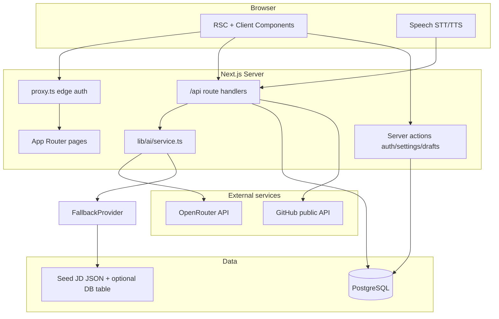

# InterviewOS — How the platform works

This document describes **InterviewOS** (this repository: `interviewpilot`). It is an AI interview **practice** product—not a resume ATS matcher, job applier, or “rewrite” tool. The design language references HireAI-style career tooling, but V1 scope is: generate questions, written practice with feedback, and spoken mock interviews with debriefs.

For deeper detail, see also [ARCHITECTURE.md](./ARCHITECTURE.md), [API.md](./API.md), [README.md](./README.md), [HARDENING.md](./HARDENING.md), [OPERATIONS.md](./OPERATIONS.md), and [COST_CONTROL.md](./COST_CONTROL.md).

---

## 1. What the product does

| Mode | What happens |
|------|----------------|
| **Written practice** | User answers questions in the workspace; the server scores the answer and returns strengths, gaps, and improvements. |
| **Mock interview** | Browser speech (mic) captures answers as **text** only; an AI interviewer decides the next question/follow-up; session ends with a **6-dimension debrief**. |
| **Question generation** | After setup, the server builds a personalized question set from the target role, pasted job description, resume summary, GitHub excerpt, and projects. |

User flows (signup → setup → generate → practice → mock → history) are documented in [README.md](./README.md#workflow). This document focuses on **where data comes from** and **how frontend and backend cooperate**.

---

## 2. Technology stack

| Layer | Technology |
|-------|------------|
| **Framework** | [Next.js 16](https://nextjs.org/) App Router, **React 19**, **TypeScript** |
| **Styling** | Tailwind CSS v4, shared UI in `src/components/ui/*` |
| **Database** | **PostgreSQL** (e.g. Neon) via **Prisma ORM** |
| **Auth** | Email + password (**bcrypt**), session **JWT in httpOnly cookie** (**jose**) |
| **AI (live)** | [OpenRouter](https://openrouter.ai/) chat completions (model from `OPENROUTER_MODEL`) |
| **AI (offline)** | Deterministic `FallbackProvider` in `src/lib/ai/fallback.ts` |
| **Resume files** | Server-side **PDF** (`pdfjs-dist`) and **DOCX** (`mammoth`) → plain text |
| **GitHub** | Public REST API (no token) for repos + capped README excerpts |
| **Voice (mock)** | Browser **Web Speech API** (STT/TTS); **no audio stored** on server |
| **Deploy** | Typical target: **Vercel** (serverless Node routes + Postgres) |

---

## 3. High-level architecture



**Rule:** API keys and AI calls stay **on the server**. The browser never receives `OPENROUTER_API_KEY`.

---

## 4. What the user provides and where it is stored

### 4.1 Account

| Input | Storage | Notes |
|-------|---------|--------|
| Name, email, password | `users` table | Password stored as **bcrypt hash** only |

### 4.2 Interview session (target job setup)

Created via `POST /api/interviews` or the new-interview flow.

| Field | DB column / table | Required |
|-------|-------------------|----------|
| Role | `interview_sessions.role` | Yes |
| Experience level | `interview_sessions.seniority` | Yes |
| Company, company type, interview type | optional columns | No |
| Pasted job description | `job_description` (text) | No |
| Question count (10/15/20) | `question_count_target` | Yes (default 10) |
| GitHub URL | `github_url` + `github_context` (JSON) | No |
| Resume | **Not** the file—only `resume_file_name` + `resume_context` (JSON) | No |
| Manual projects | `candidate_projects` rows | No (max 8) |

**Resume upload:** `POST /api/interviews/[id]/resume` accepts PDF/DOCX (≤3 MB). Text is extracted in memory; the **binary file is not persisted**. Structured fields (skills, experience, etc.) are saved in `resume_context` after AI or heuristic extraction.

**GitHub:** `POST /api/interviews/[id]/github` fetches **public** profile/repos; README snippets are summarized into `github_context`.

### 4.3 Generated interview content

After `POST /api/interviews/[id]/generate`:

| Data | Storage |
|------|---------|
| Each question (text, category, difficulty, reason, suggested answer, follow-ups, source tags) | `interview_questions` |
| Written draft while typing | `interview_questions.draft_answer` (+ optional `localStorage` buffer client-side) |
| Submitted written attempts | `question_attempts` (answer, score, feedback JSON) |

Generation is **one-time per session** (409 if questions already exist). Questions are read from the DB during practice—no repeat AI calls per tab switch.

### 4.4 Mock interview

| Data | Storage |
|------|---------|
| Mock session (status, max questions, overall score) | `mock_interview_sessions` |
| Transcript turns (AI / CANDIDATE text) | `interview_turns` |
| Debrief (6 dimensions, strengths, weaknesses, etc.) | `mock_interview_sessions.debrief` (JSON) + `overall_score` |

Audio/video: **not stored**. Only transcript strings are sent to the server.

### 4.5 Seed job-description dataset (not user data)

| Artifact | Purpose |
|----------|---------|
| `prisma/seed-data/job-descriptions.json` | Offline catalog of synthetic JD variants per role/seniority/company type |
| `job_description_templates` table | Optional DB mirror via `npm run seed:jds:load` |

Used mainly when **OpenRouter is off** to ground the fallback question bank. The user’s **pasted JD** overrides seed skills when present (`src/lib/ai/jd-text.ts`, `jd-questions.ts`).

---

## 5. Where information is fetched from (external)

| Source | When | What is pulled |
|--------|------|----------------|
| **OpenRouter** | Live AI: generate, evaluate, follow-ups, resume structure, mock interviewer, debrief | Chat completion JSON (models configurable) |
| **GitHub API** | User attaches profile URL | Public repos, languages; up to 3 README excerpts |
| **User’s machine** | Resume upload | File bytes → text in request only |
| **Browser speech APIs** | Mock interview | Live transcription → text in API body |
| **Seed JSON / DB** | Fallback generation | Role-matched skills, responsibilities, focus areas |

There is **no** scraping of job boards, no LinkedIn integration, and no automatic job matching to external listings in V1.

---

## 6. Frontend — how pages work

| Area | Pattern |
|------|---------|
| **Marketing** | `src/app/page.tsx` — static/SSR landing + lazy demo |
| **Authenticated app** | `src/app/(app)/*` — layouts, dashboard, lists, workspace |
| **Focus mock** | `src/app/(focus)/mock/[id]` — minimal chrome for spoken UI |
| **Auth** | `src/app/(auth)/*` — forms → **server actions** (`auth-actions.ts`) |
| **Protection** | `src/proxy.ts` — redirects unauthenticated users before RSC/DB |

**Client components** handle interactivity: workspace (`interview-workspace.tsx`), mock UI (`mock-interview.tsx`), generation stream (`generate-interview.tsx`), charts, command palette.

**Data loading:** Server Components call `src/lib/data.ts` (Prisma, scoped by `userId`). Mutations use Route Handlers under `src/app/api/**` or server actions (draft autosave, auth).

---

## 7. Backend — API and AI facade

### 7.1 Main API surfaces

Documented in [API.md](./API.md). Examples:

- Interviews CRUD, generate (NDJSON stream), resume/GitHub attach  
- `POST /api/questions/[id]/evaluate` — written scoring  
- `POST /api/questions/[id]/follow-up` — new follow-up questions  
- Mock: create, turn, end, debrief, history  
- `GET /api/health` — DB readiness (and config/AI mode hints when extended)

Every protected handler uses `requireApiUser()` and filters rows by **`userId`** (see `src/lib/owned-resource.ts`).

### 7.2 AI entry point

All AI work goes through **`src/lib/ai/service.ts`**:

1. Sanitize untrusted text (`sanitize.ts` / `guardText`)  
2. Optionally read **content-hash cache** (`stable-input-cache.ts`, ~10 min TTL)  
3. Try **OpenRouter** (`openrouter.ts`) with timeouts, validation, one repair retry on bad JSON  
4. On failure or missing key → **FallbackProvider**  
5. Post-process: resume/suggested-answer/debrief **grounding** (no invented facts)

Provider responses include `provider` (and `model` when live) so the UI can show fallback notices.

### 7.3 Scoring formulas (practice only)

| Output | How it is produced |
|--------|---------------------|
| **Written score** | Model JSON validated by `parseEvaluation`; score clamped 0–100; heuristic backfill if feedback arrays empty |
| **Fallback written score** | `evaluation-heuristic.ts` (deterministic signals: length, example, structure, result language) |
| **Debrief overall** | Weighted sum of six dimensions (`DEBRIEF_WEIGHTS` in `validate.ts`); headline score aligned to breakdown |

---

## 8. Security, limits, and reliability (summary)

- **Rate limits:** Per-user buckets on AI/expensive routes (`src/lib/ai-rate-limits.ts`, `rate-limit.ts`); auth has separate IP limits.  
- **Env validation:** `instrumentation.ts` → `assertEnv()` at server boot.  
- **Logging:** AI failures truncated/redacted (`safe-log.ts`, `ops-log.ts`); no raw resumes in logs.  
- **Retries:** Transient OpenRouter errors only; permanent 4xx falls back quickly.  

---

## 9. Key directories (quick map)

```
src/app/              Routes (pages + API)
src/components/       UI (workspace, mock, forms, ui primitives)
src/lib/
  ai/                 Prompts, providers, validation, grounding, cache
  data.ts             DB reads for pages
  auth.ts             Session cookie
  validation.ts       Zod schemas shared with API
  resume.ts, github.ts  Ingestion helpers
prisma/schema.prisma  Database models
prisma/seed-data/     Generated JD dataset JSON
tests/                Node test runner (tsx --test)
```

---

## 10. Environment variables (runtime)

| Variable | Role |
|----------|------|
| `DATABASE_URL` | Postgres connection |
| `AUTH_SECRET` | Cookie signing (≥16 chars) |
| `OPENROUTER_API_KEY` | Required in **production** for live AI |
| `OPENROUTER_MODEL` | Optional primary model |
| `OPENROUTER_CHEAP_MODEL` | Optional cheaper model for resume extraction only |
| `APP_URL` | Canonical site URL (OpenRouter referrer, links) |

See [OPERATIONS.md](./OPERATIONS.md) for operations and health checks.

---

## 11. Local development checklist

```bash
npm install
cp .env.example .env    # fill DATABASE_URL, AUTH_SECRET, optional OpenRouter
npx prisma migrate dev
npm run dev             # http://localhost:3000
npm test
npm run build
```

Demo data: `npm run db:seed`.

---

## 12. What this repo does **not** include (V1)

Per [ROADMAP.md](./ROADMAP.md), out of scope here:

- ATS resume optimizer / keyword scanner product surface  
- Stealth interview copilot  
- Automated job applications (“Smart Apply”)  
- Storing raw resume PDFs in the database  

Accuracy and matching in this codebase mean: **grounded question generation**, **JD skill extraction**, **answer scoring**, and **debrief analysis**—all tied to content the user (or the seed catalog) actually provided.

---

*Last aligned with the `interviewpilot` codebase (Next.js 16, Prisma 6, OpenRouter integration). Update this file when major architecture or data contracts change.*